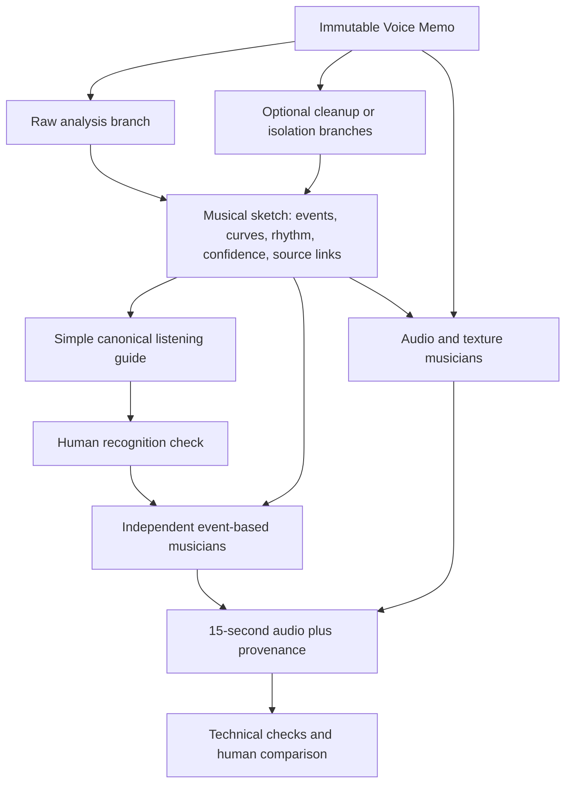

# MIT 2.009 House Band — living research notebook

**Research checkpoint: September 22, 2026. Status: proposed experiments, awaiting Danny's review. No new audio engine, model installation, hosting, architecture migration or application change was performed for this research.**

The student makes a tiny musical gesture. The software offers genuinely different things that gesture could become. Some performers preserve it closely; others keep only its rhythm, contour, fragments or texture. Human curiosity and selection are central.

The strongest next step is a small comparative audition, not choosing one music-generation model. The investigation covers **64 distinct inventory repositories, 65 purpose-specific entries, and 67 dated repository evidence snapshots**. These are curated candidates, not an exhaustive catalog of every audio project. [Inventory](INVENTORY.md) · [12 experiment protocols](EXPERIMENTS.md) · [CSV](inventory.csv) · [Machine-readable inventory](inventory.json) · [Evidence snapshot](sources.json) · [Experiment parameters](experiment-plan.json).

## Listening-session update

Danny has reviewed the research and begun experiments with a new recording. Early guide checks exposed a missing expressive arc. His clarification is now a product requirement: the seed must be interpreted without musical coaching. See [the audio-only interpretation protocol](AUDIO-ONLY-INTERPRETATION.md). Hand-shaped demonstrations are references, not completed automatic interpretation. An isolated [audio-only pilot](../../experiments/README.md) now renders three adapted E01/E02/E04 interpretations from a fresh analysis; listening review rejected all three for insufficient sound quality. A single [MRT2 performance trial](MRT2-TRIAL.md) received a positive sound-quality result; source recognition still needs improvement. Two new comparisons test stronger note guidance and automatic lead placement; both were retained as viable interpretations with recognizable source material. Both are retained as viable choices, with no winner selected. Expressive fidelity and results on unseen recordings remain unresolved. The full application architecture remains undecided.

## What the research changes

1. **MIDI is a useful common language, but an insufficient master record.** Keep original audio, continuous pitch and loudness, onset events, phrase boundaries, alternate note hypotheses and confidence. Export MIDI when a musician needs it. Tapping should produce useful rhythmic events without invented pitches; a whistle slide should not have to become rigid piano notes. Basic Pitch, pYIN and torchcrepe have different outputs and failure modes. [Basic Pitch](https://github.com/spotify/basic-pitch), [librosa](https://github.com/librosa/librosa), [torchcrepe](https://github.com/maxrmorrison/torchcrepe).
2. **Cleanup should be an optional branch.** Speech enhancement is not musical-source isolation. Keep the untreated recording as a control; compare conservative cleanup when useful. A speech-trained suppressor may remove the very whistle, breath or tap we want. Music-stem separation also cannot reliably select the student from nearby voices. These are task-specific risks to test, not claims every cleaner always fails. [RNNoise](https://github.com/xiph/rnnoise), [DeepFilterNet](https://github.com/Rikorose/DeepFilterNet), [Demucs](https://github.com/adefossez/demucs).
3. **Rendering and composition are different problems.** A better sample library cannot make a repetitive accompaniment interesting. Conversely, a compelling motif transformation may sound poor through a weak patch. Compare arrangement algorithms through a shared sound first, then compare renderers. FluidSynth, Surge, SuperCollider and Faust are instruments/workbenches, not finished arrangers. [FluidSynth](https://github.com/FluidSynth/fluidsynth), [Surge XT](https://github.com/surge-synthesizer/surge), [SuperCollider](https://github.com/supercollider/supercollider), [Faust](https://github.com/grame-cncm/faust).
4. **There are inexpensive approaches well beyond conventional generative AI.** Pattern algebra, constraint-based harmony, event-memory improvisation, physical models, granular resynthesis and corpus mosaics can all respond to the input. They offer controllable differences that random seeds alone do not. [isobar](https://github.com/ideoforms/isobar), [music21](https://github.com/cuthbertLab/music21), [Dicy2 Python](https://github.com/DYCI2/Dicy2-python), [FluCoMa](https://github.com/flucoma/flucoma-core).
5. **There is a relevant newer local neural option.** Magenta RealTime 2 accepts per-frame MIDI control as well as context audio and style conditioning, and has an official Apple Silicon implementation. That makes it a more direct house-band experiment than a text-only generator. Its audio-style embedding is distinct from melody control. Its small model is a trial candidate, not a proven solution for our inputs. [Model card](https://github.com/magenta/magenta-realtime/blob/main/MODEL.md), [hardware documentation](https://github.com/magenta/magenta-realtime/blob/main/docs/models.md).

## Ranked by purpose, not overall quality

These are proposed starting orders *within each job*. The full inventory includes alternatives, maintenance evidence, constraints and reasons to defer.

| Job | Start with | Compare next | Why |
|---|---|---|---|
| Hear the student's pitched idea | Existing pYIN, Basic Pitch | torchcrepe, PESTO | Preserve current accepted guide and compare independent hypotheses. |
| Hear tapping and loose rhythm | Onsets in librosa/aubio | Beat This! when there is enough pulse | Onsets are evidence; meter and tempo are hypotheses. |
| Clean troublesome recordings | Raw control, light noisereduce | DeepFilterNet/RNNoise, selected separation only when indicated | Avoid forcing all sounds through speech cleanup. |
| Share musical information | Small JSON sidecar plus Mido/pretty_midi export | Partitura | Keep seconds, bends and uncertainty outside MIDI. |
| Develop motifs cheaply | isobar or a small deterministic recipe | SCAMP, Dicy2 | Change musical structure, not just instrumentation. |
| Add alternative harmonies | music21-assisted custom rules, MMA | Notochord; AccoMontage2 after asset review | Different approaches have different assumptions about harmony and time. |
| Make rhythm from input | Tap/onset-derived patterns and synthesis | Hydrogen; later GrooVAE comparison | The student can contribute rhythm without a tune. |
| Render convincing or deliberately synthetic sound | Existing samples as control; SuperCollider/FluidSynth | Surge/Faust through Pedalboard or DawDreamer | Instrument quality and articulation can be auditioned independently. |
| Produce strange audio transformations | FluCoMa, granular synthesis, Signalsmith Stretch | PaulXStretch, Dicy2/audio corpus work | Preserve gesture or fragments when note fidelity is not the goal. |
| Test learned timbre or a neural band | DDSP; Magenta RealTime 2 small | RAVE/AFTER conditional on terms; ACE-Step cover mode | Test separate musical hypotheses, with no paid API. |

## Twelve proposed band members

Each gets the same source package and emits a 15-second candidate. These are different mechanisms, not twelve genre prompts. Detailed parameters, inputs, control conditions and failure criteria are in [EXPERIMENTS.md](EXPERIMENTS.md).

| ID | Musician | Behavior | Character | First environment |
|---|---|---|---|---|
| E01 | Faithful player | Preserve note order/onsets and perform with purposeful articulation | Conservative | Current Mac CPU |
| E02 | Groove translator | Reinterpret timing with straight/swing/offbeat alternatives | Playful | Mac CPU |
| E03 | Reharmonizing trio | Keep melody, search several chord/bass/inner-voice paths | Conservative to playful | Mac CPU |
| E04 | Motif improviser | Repeat, invert, sequence and answer short fragments | Playful | Mac CPU; optional Notochord |
| E05 | Tap-to-band drummer | Turn attacks and relative accents into kick/snare/hat/bass interplay | Playful | Mac CPU |
| E06 | Phrase memory player | Recombine labeled fragments with Dicy2 rather than a large model | Playful to strange | Mac CPU; Linux portability unverified |
| E07 | Granular sculptor | Scatter and retune tiny source-derived grains into a rhythmic instrument | Strange | Mac CPU |
| E08 | Mosaic orchestrator | Match the phrase's contour/energy to tiny instrument fragments | Playful to strange | Mac CPU, FluCoMa |
| E09 | Physical instrument builder | Excite resonators/plucked strings using the input's timing and dynamics | Playful | Mac CPU, Faust/Csound |
| E10 | Timbre shape-shifter | Revoice continuous pitch/dynamics, then test latent transformations | Expressive to strange | Mac DDSP; RAVE/AFTER conditional |
| E11 | MIDI-following neural band | Feed canonical note events to Magenta RealTime 2 | Flexible | Apple Silicon; NVIDIA alternative |
| E12 | Free cover artist | Transform a rendered phrase through ACE-Step source/cover conditioning | More adventurous | Apple Silicon; GPU server alternative |

## A candidate architecture to test, not adopt yet

A single mandatory cleanup → transcription → MIDI chain throws away useful information and makes transcription the gatekeeper. A more useful hypothesis has two cooperating paths:

The raw-audio arrow is a capability, not the default permission to put recognizable singing into an output. Danny's earlier preference for no intelligible lyrics still applies. Begin audio transformations with the voice-free guide or nonvocal taps; raw-vocal transformations need an explicit experiment choice and a listening check. Reversing, chopping or passing through a neural model does not guarantee words become unrecognizable.

Do not force every musician to consume everything. Declare required inputs: reliable notes, reliable attacks, continuous f0, audio fragments, or a combination. When pitch is weak, try a rhythmic/texture musician. When meter is uncertain, use free-time events or several labeled tempo hypotheses. Do not present noise-derived notes as a confident melody. Allow the listener to reject a guide without rejecting their musical contribution.

**Proposed sketch information:** immutable source hashes and original-time coordinates; analysis branch/version; note candidates with seconds and pitch cents; voicing/confidence curves; onset strength; pitch and loudness envelopes; phrase/rest boundaries; optional beat/key hypotheses with confidence; source slice references; and a separately versioned accepted guide. No schema migration is authorized by this document.

A musician's output should include its event score or source-slice mapping, random seed, transformation settings, renderer/patch/model hashes, and an explanation such as “kept your rhythm, developed the first three notes.” For adventurous versions, record what was changed. The listener decides whether enough musical DNA remains. A numerical similarity score is a diagnostic, not an automatic creative ranking.

**Duration:** `project.duration_seconds = 15.0` remains a project setting. All musicians receive that value, reserve an ending/tail, and return exactly 720,000 stereo sample frames at 48 kHz for V1. Musical bars are internal planning units; some meters/tempos need a partial closing bar. A human-facing duration slider remains out of scope. Other durations should later work by changing configuration, not by editing each musician.

## Which things can run here?

This Mac reports Apple Silicon/arm64, macOS 26.6.2 and 48 GiB memory. This is a hardware observation, not a new performance benchmark.

| Lane | Candidates | What is actually known |
|---|---|---|
| Immediately available baseline | Existing pYIN guide, current sampler/synth, NumPy/SciPy, FFmpeg | Already used in this project; E01 and a small E02/E04 study need no new model. |
| Mac CPU, new isolated setup | Basic Pitch, torchcrepe/PESTO, noisereduce, isobar, music21, MMA, SuperCollider, FluCoMa, Notochord, DSP hosts | Plausible or documented Mac support; none newly installed or benchmarked for this research. Basic Pitch has version constraints. |
| Mac acceleration, larger downloads | MRT2 small, ACE-Step; MuScriptor, AFTER conditionally | Apple paths documented. Checkpoint terms, disk/RAM and fidelity still require trials. No discrete NVIDIA card is required for these Apple paths. |
| Prefer Linux/NVIDIA research worker | GETMusic, MT3, MusicGen Melody; heavier separation/large-model batches | CUDA/JAX research stacks or throughput make a server more practical. This is a recommendation, not proof CPU/Mac is impossible. |
| Training rather than inference | RAVE/AFTER custom models, DDSP training, larger model adaptation | Separate GPU project; unnecessary for first auditions. RAVE lists training configurations from 5 to 32 GB GPU memory. Do not confuse these with pretrained inference requirements. |

## Smallest experiment that teaches the most

**One accepted melody, three algorithms, two seeds: six 15-second auditions plus the existing guide.** Use Danny's accepted score and the existing renderer, keep the same lead sound and comparable loudness, and test E01 faithful playing, E02 groove reinterpretation and E04 motif development. The only intended variable is how the phrase is treated. For each seed, generate all three methods; record the seed even when the faithful baseline is deterministic.

This answers the unresolved question “Do different musical behaviors create interesting choices?” more cleanly than another three-instrument swap. It can be built as an isolated experiment script, without a new interface, plugin framework, model download or server. Estimated implementation scope is one short development session plus listening, not a promised runtime. The exact recipe is in the experiment document.

If this is musically promising, add a tap-only fixture and compare pYIN/Basic Pitch on noisy recordings. If the structure works but tone still disappoints, test the same score through better renderers or MRT2 before adding more composition algorithms. If none feels connected or interesting, revise the musical behaviors rather than scaling generation volume.

## Evaluation: preserve accidents without confusing them with defects

Keep a small, consented local corpus: clean hum, off-key singing, whistle/glissando, tapping, variable volume, room echo, machinery and overlapping conversation. For known synthetic/clean gestures, create controlled noisy variants without uploading recordings. Real messy recordings remain necessary; artificial noise alone is not enough.

Technical checks: decode formats, preserve originals, finite samples, fixed length, early meaningful sound, clipping/true peak, deterministic replay where applicable, sample/model provenance and no network calls during generation. Inspect whether cleanup improved downstream pitch/onset recovery, not merely whether it sounds quieter.

Musical review: ask separately “Can I recognize something I contributed?”, “Does it make me want to listen again?”, “Is it meaningfully different?”, and “Would I choose it?” Include “none” and retain interesting failures. Compare loudness-matched, unlabeled orderings. Do not aggregate everything into one automatic quality score. Conservative experiments should satisfy exact event constraints; adventurous ones should expose their transformations, not fail simply for being different.

## License and maintenance findings that affect choices

- Several excellent components are permissive: Basic Pitch, isobar, music21, Mido, Signalsmith, FluCoMa. Copyleft tools can also be useful, but their integration/distribution obligations need to be respected. Do not assume a subprocess boundary automatically settles those obligations.
- RAVE and AFTER use noncommercial licenses. MusicGen and MuScriptor have restricted weights despite permissive code. They are conditional research options, not a default unrestricted open-source stack. MRT2 publishes Apache-2.0 code and CC-BY-4.0 weights with additional usage terms in its model card.
- The original Demucs repository is archived; the author's separate repository has recent activity. sfizz and the original Magenta parent repository are archived. Tidal's GitHub repository explicitly moved development to [Codeberg](https://codeberg.org/uzu/tidal), so a quiet GitHub mirror should not be called a dead project.
- Current NeuralNote v2 uses MuScriptor, not the older Basic Pitch backend; v2's build, platform and weight restrictions differ from v1.
- MusicLang's README and license file disagree on BSD clause count. AccoMontage2 code is MIT, but the external MIDI-pack-derived data and checkpoint terms need review. AudioGuide's root licensing was not established. Unknowns are recorded rather than guessed.
- CC0 instrument libraries license the recordings; that is separate from copyright in a melody a student sings. Danny's existing tune is a private regression fixture; public demos should use an original or otherwise cleared phrase.

## Living-research and handoff rules

The JSON/CSV inventory stores purpose priority, inputs, license notes, platform/hardware estimates, integration difficulty, trial recommendation, last verification and exact source commits. `sources.json` also records README/license blob hashes and model-documentation sources. This makes later updates auditable without pretending a mutable GitHub URL is a pinned dependency.

Before implementing an experiment, create an isolated environment/work directory, pin the chosen source commit and all transitive packages, record model/sample hashes and terms, then archive the resolved lockfile. The source snapshot is not an install lockfile. Document installation failures as results. Do not merge legacy TensorFlow, current Torch, MLX and plugin-host requirements into the application environment.

`refresh_sources.py` is a read-only upstream metadata refresh helper. It writes a new dated snapshot and does not overwrite recommendations or approve a model. It uses an existing GitHub CLI login or public API access; it does not install software, download weights or upload audio. No scheduled monitoring is configured.

**Stop point:** review these experiments with Danny. The production prototype stays at its existing behavior until an experiment is selected. No single backend, canonical-schema implementation, server purchase or public student workflow is chosen here. The current private application has no new application-level open-source license assigned; selecting that license belongs with the eventual component/dependency review, not an automatic blanket relicensing today.

## Additional leads and deliberate omissions

- [AudioStellar](https://gitlab.com/ayrsd/audiostellar): intriguing corpus-space instrument; source located on GitLab, but this pass did not establish its current licensing/platform requirements sufficiently for a full recommendation. Follow up if visual corpus navigation matters; do not require its UI for students.
- [Tidal](https://codeberg.org/uzu/tidal): a strong pattern-language alternative, particularly for live rhythmic experimentation. GitHub migration verified; current Codeberg release/license/deployment details need a focused follow-up before pinning. isobar/SuperCollider cover the first offline study with fewer moving pieces.
- [NES-MDB](https://github.com/chrisdonahue/nesmdb): useful chiptune representation/rendering ideas; its game-music dataset is not automatically licensed for our demo/training use. We can create an original restricted-voice synth experiment without importing that corpus.
- Text-only generation, commercial DAWs as required hosts, paid music APIs and custom model training are outside the first trial. A free desktop GUI is not automatically a good unattended server component.

## Research log

| Date | Change | Evidence / next check |
|---|---|---|
| 2026-09-22 | Broad ecosystem research and 12 proposed experiments | 67 repository snapshots plus official model/inference documents; no new audio benchmarks. |
| Pending | Danny chooses the first experiment | Keep architecture provisional. |
| Pending | Record first listening results and installation locks | Update inventory test status and experiment outcomes; retain failures. |

## Peer listening round

Six additional orchestration directions (D–I) and a portable nine-version listening pack are ready. See [the trial record](MRT2-TRIAL.md) for fixed settings, reproduction and checks, and [Music in plain language](MUSIC-IN-PLAIN-LANGUAGE.md) for the vocabulary and current detection limits. Feedback remains pending for the new outputs. This is a bounded style comparison before tests on unfamiliar recordings, not an application architecture decision.
